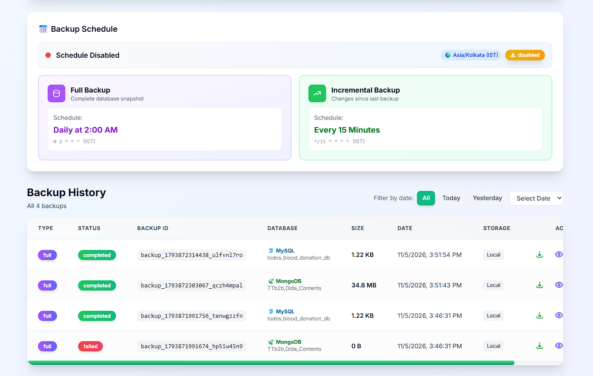
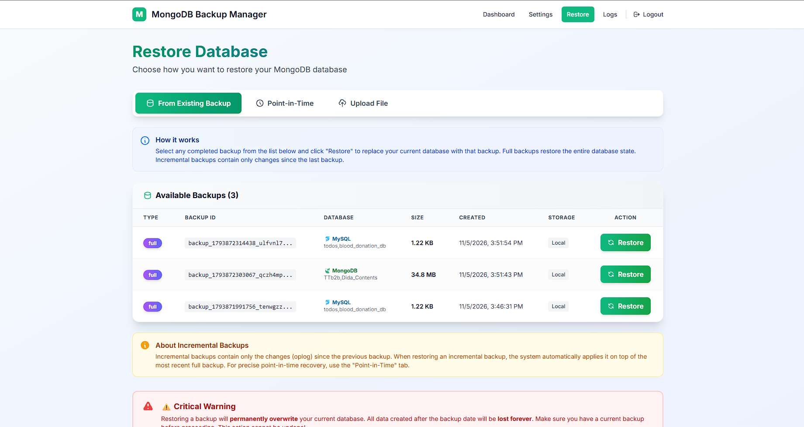

# MongoDB & MySQL Backup Manager

A production-ready, web-based database backup solution for **MongoDB and MySQL** with scheduling, FTP upload, incremental backups, and point-in-time recovery capabilities.


## Project Status

This project is actively developed and has been tested in real-world self-hosted MongoDB environments.

While core features such as full backups, incremental backups, scheduling, and restore workflows are stable, users are encouraged to test the setup in a non-production environment before relying on it for critical data.

Contributions, testing feedback, and issue reports are welcome.

> ⚠️ **Important**: For incremental backups and PITR to work, the target database's change log must be enabled:
> - **MongoDB**: must run as a Replica Set (even single-node) to expose the `oplog`
> - **MySQL**: must have the binary log enabled (`log_bin=ON`, `binlog_format=ROW`)
>
> Full backups work without either of these.

---

## Features

**Backup Management**
- Full database backups with compression (gzip/tar)
- Incremental backups using MongoDB oplog or MySQL binlog
- Point-in-time recovery (PITR) support
- Automatic backup rotation and retention policies
- Pluggable engine layer (MongoDB and MySQL/MariaDB supported)

**Storage & Transfer**
- Local backup storage with configurable retention
- FTP/SFTP upload to remote servers
- Automatic cleanup of old backups

**Scheduling & Automation**
- Flexible cron-based scheduling
- Separate schedules for full and incremental backups
- Real-time backup status monitoring

**Security**
- JWT-based authentication
- Encrypted credential storage
- Password change support

**User Interface**
- Clean, responsive web dashboard
- Real-time backup progress tracking
- Log viewing and filtering
- Backup inspection and verification


## Screenshots

### Dashboard


### Backup Management


### Restore Operations


---

## Quick Start

### Using Docker (Recommended)

```bash
# Clone the repository
git clone https://github.com/likhith1409/MongoDB-Backup-Manager.git
cd MongoDB-Backup-Manager

# Copy environment file and configure
cp .env.example .env
# Edit .env with your settings

# Start with Docker Compose
docker-compose up -d
```

Access the dashboard at **http://localhost:5552**

Default credentials:
- Username: `admin`
- Password: `admin`

> ⚠️ **Important**: Change the default credentials immediately after first login!

### Manual Installation

**Prerequisites**
- Node.js 18 or higher
- MongoDB Tools (`mongodump`, `mongorestore`)
- MariaDB/MySQL client tools (`mysqldump`, `mysql`, `mysqlbinlog`) — only needed for MySQL backups
- MongoDB Replica Set or MySQL binary logging (Required for incremental backups)
- npm or yarn

**Steps**

```bash
# Clone the repository
git clone https://github.com/likhith1409/MongoDB-Backup-Manager.git
cd MongoDB-Backup-Manager

# Install all dependencies
npm run install:all

# Copy and configure environment
cp .env.example .env
# Edit .env with your MongoDB connection and other settings

# Build the frontend
npm run build

# Start the server
npm start
```

**Development Mode**

```bash
# Start both frontend and backend in development mode
npm run dev
```

- Frontend: http://localhost:5551
- Backend API: http://localhost:5552

---

## Configuration

### Environment Variables

| Variable | Description | Default |
|----------|-------------|---------|
| `PORT` | Backend server port | `5552` |
| `HOST` | Server bind address | `0.0.0.0` |
| `NODE_ENV` | Environment mode | `production` |
| `ADMIN_USER` | Admin username | `admin` |
| `ADMIN_PASS` | Admin password | `admin` |
| `JWT_SECRET` | JWT signing secret | - |
| `DB_ENGINE` | Database engine: `mongodb` or `mysql` | `mongodb` |
| `MONGO_URL` | MongoDB connection string | - |
| `MYSQL_HOST` | MySQL server hostname | - |
| `MYSQL_PORT` | MySQL server port | `3306` |
| `MYSQL_USER` | MySQL username | - |
| `MYSQL_PASSWORD` | MySQL password | - |
| `MYSQL_DATABASE` | MySQL database (empty = all databases) | - |
| `FTP_HOST` | FTP server hostname | - |
| `FTP_PORT` | FTP server port | `21` |
| `FTP_USER` | FTP username | - |
| `FTP_PASSWORD` | FTP password | - |
| `FTP_BASE_PATH` | FTP upload directory | `/backups` |
| `FTP_ENABLED` | Enable FTP uploads | `false` |
| `KEEP_LOCAL_BACKUPS` | Keep local copies | `true` |
| `KEEP_LAST_N_BACKUPS` | Max local backups | `30` |
| `RETENTION_DAYS` | Auto-delete after days | `30` |
| `BACKUP_CRON` | Backup schedule (cron) | `0 2 * * *` |
| `SETTINGS_ENCRYPTION_KEY` | Encryption key (32+ chars) | - |

### Cron Schedule Examples

| Expression | Description |
|------------|-------------|
| `0 2 * * *` | Daily at 2:00 AM |
| `0 */6 * * *` | Every 6 hours |
| `0 0 * * 0` | Weekly on Sunday |
| `0 0 1 * *` | Monthly on the 1st |

---

## MySQL Backups

The app supports MySQL/MariaDB alongside MongoDB — enable one or both engines in **Settings → Database Engines**. Each engine backs up independently on the same schedules, and backups/restore chains are tracked per engine. You can also set `DB_ENGINE` / `MONGO_ENABLED` / `MYSQL_ENABLED` via environment.

### Connection

Configure host, port, user, password, and (optionally) a single database in **Settings → MySQL Configuration**, or via the `MYSQL_*` environment variables. Leave the database empty to back up **all databases**.

> **Docker users**: use `host.docker.internal` as the host to reach a MySQL server running on the host machine. Make sure MySQL's `bind-address` accepts remote connections and the user is granted with a host wildcard (e.g. `'backup'@'%'`).

**Required user privileges:**

```sql
CREATE USER 'backup'@'%' IDENTIFIED WITH mysql_native_password BY 'strongpassword';
GRANT SELECT, RELOAD, LOCK TABLES, REPLICATION CLIENT, REPLICATION SLAVE ON *.* TO 'backup'@'%';
FLUSH PRIVILEGES;
```

> ⚠️ MariaDB client tools (used by the Docker image) may not support MySQL 8's default `caching_sha2_password` auth plugin — create the backup user with `mysql_native_password` as shown above.

### Incremental backups & PITR (binary log)

Incremental MySQL backups dump a slice of the **binary log** (the MySQL equivalent of MongoDB's oplog). Enable it on the server:

```ini
# my.cnf / my.ini — then restart MySQL
[mysqld]
server_id = 1
log_bin = mysql-bin
binlog_format = ROW
```

Verify with:

```sql
SHOW VARIABLES LIKE 'log_bin';  -- should be ON
```

The dashboard PITR card shows "Binary logging enabled" when detected. Full backups work regardless; they embed consistent binlog coordinates via `mysqldump --master-data=2` (requires `RELOAD` privilege) so incrementals resume from the exact snapshot point.

**File formats**: full backups are `*.sql.gz` (SQL dump); incrementals are `*.binlog.sql.gz` (`mysqlbinlog` output). Restores pipe the SQL into the `mysql` client.

---

## Project Structure

```
mongodb-backup-manager/
├── client/                 # React frontend (Vite + Tailwind)
│   ├── src/
│   │   ├── components/     # Reusable UI components
│   │   ├── contexts/       # React contexts
│   │   ├── pages/          # Page components
│   │   └── utils/          # Utilities and API client
│   └── ...
├── server/                 # Express backend
│   ├── middleware/         # Auth and other middleware
│   ├── routes/             # API route handlers
│   ├── services/           # Core business logic
│   │   └── engines/        # Per-engine adapters (MongoEngine, MysqlEngine)
│   └── tests/              # Unit tests
├── data/                   # Backups and database (gitignored)
├── docker-compose.yml      # Docker Compose configuration
├── Dockerfile              # Multi-stage Docker build
└── .env.example            # Environment template
```

---

## API Reference

### Authentication
| Method | Endpoint | Description |
|--------|----------|-------------|
| POST | `/api/auth/login` | Login and get JWT token |
| POST | `/api/auth/logout` | Logout |
| POST | `/api/auth/change-password` | Change password |

### Backups
| Method | Endpoint | Description |
|--------|----------|-------------|
| GET | `/api/backup/list` | List all backups |
| POST | `/api/backup/full` | Trigger full backup |
| POST | `/api/backup/incremental` | Trigger incremental backup |
| GET | `/api/backup/:id/inspect` | Inspect backup contents |
| DELETE | `/api/backup/:id` | Delete a backup |

### Restore
| Method | Endpoint | Description |
|--------|----------|-------------|
| POST | `/api/restore/:id` | Restore from backup |
| POST | `/api/restore/pitr` | Point-in-time restore |

### Settings
| Method | Endpoint | Description |
|--------|----------|-------------|
| GET | `/api/settings` | Get current settings |
| PUT | `/api/settings` | Update settings |
| POST | `/api/settings/test-ftp` | Test FTP connection |
| POST | `/api/settings/test-db` | Test database engine connection |

### Logs
| Method | Endpoint | Description |
|--------|----------|-------------|
| GET | `/api/logs` | Get backup logs |

### Health
| Method | Endpoint | Description |
|--------|----------|-------------|
| GET | `/health` | Health check endpoint |

---

## Deployment

### Systemd Service (Linux)

```bash
# Copy service file
sudo cp mongodb-backup.service /etc/systemd/system/

# Reload systemd
sudo systemctl daemon-reload

# Enable and start service
sudo systemctl enable mongodb-backup-manager
sudo systemctl start mongodb-backup-manager

# Check status
sudo systemctl status mongodb-backup-manager
```

### Docker Production

```bash
# Build and run
docker-compose up -d

# View logs
docker-compose logs -f app

# Stop
docker-compose down
```

### Clean Build

Use this when dependencies change, the image behaves unexpectedly, or cached layers hide problems:

```bash
# Stop the container and rebuild everything from scratch (no layer cache)
docker compose build --no-cache
docker compose up -d

# One-liner
docker compose up -d --build --force-recreate
```

> 💡 Your settings and backups survive a clean build — they live in the named volumes (`mongodb-backup-data`, `mongodb-backup-logs`).

To also wipe settings and backup history (full reset — **deletes all stored data**):

```bash
docker compose down -v        # removes the named volumes
docker compose build --no-cache
docker compose up -d
```

For a local (non-Docker) clean build:

```bash
# Reinstall all dependencies from scratch
rm -rf node_modules client/node_modules server/node_modules
npm run install:all

# Rebuild the frontend
npm run build

# Start
npm start
```

### Nginx Reverse Proxy (Optional)

```nginx
server {
    listen 80;
    server_name backup.yourdomain.com;

    location / {
        proxy_pass http://localhost:5552;
        proxy_http_version 1.1;
        proxy_set_header Upgrade $http_upgrade;
        proxy_set_header Connection 'upgrade';
        proxy_set_header Host $host;
        proxy_set_header X-Real-IP $remote_addr;
        proxy_cache_bypass $http_upgrade;
    }
}
```

---

## Troubleshooting

### Common Issues

**Cannot connect to MongoDB**
- Verify the `MONGO_URL` is correct and accessible
- Check if MongoDB is running and accepting connections
- Ensure network/firewall allows the connection

**Cannot connect to MySQL**
- Verify `MYSQL_*` settings (or the Settings page fields) — host, port, user, password
- From Docker, use `host.docker.internal` for a server on the host machine, not `localhost`/`127.0.0.1`
- Check MySQL `bind-address` is not `127.0.0.1`-only and the user host pattern allows the connection (`'user'@'%'`)
- For `caching_sha2_password` auth errors, recreate the user `IDENTIFIED WITH mysql_native_password`

**MySQL incremental backup fails with "Binlogging on server not active" / "log_bin=OFF"**
- Enable the binary log in `my.cnf`/`my.ini` (`log_bin`, `server_id`, `binlog_format=ROW`) and restart MySQL
- Full backups work without binlog; only incremental/PITR require it

**Backups failing**
- Check if `mongodump` is installed and in PATH
- Verify MongoDB user has backup privileges
- Check available disk space

**FTP upload failing**
- Test FTP connection from Settings page
- Verify FTP credentials and permissions
- Check if passive mode is required

**Authentication issues**
- Clear browser localStorage and try again
- Check if JWT_SECRET is configured
- Verify ADMIN_USER/ADMIN_PASS in .env

### Logs

View application logs:
```bash
# Docker
docker-compose logs -f app

# Systemd
journalctl -u mongodb-backup-manager -f

# Manual
cat server/logs/app.log
```

---

## Contributing

Contributions are welcome! Please read our [Contributing Guide](CONTRIBUTING.md) for details on:
- Development setup
- Code style guidelines
- Pull request process
- Issue reporting

---

## License

This project is licensed under the MIT License - see the [LICENSE](LICENSE) file for details.

---

## Acknowledgments

- MongoDB for the excellent database tools
- The Node.js and Express communities
- All contributors and users of this project
